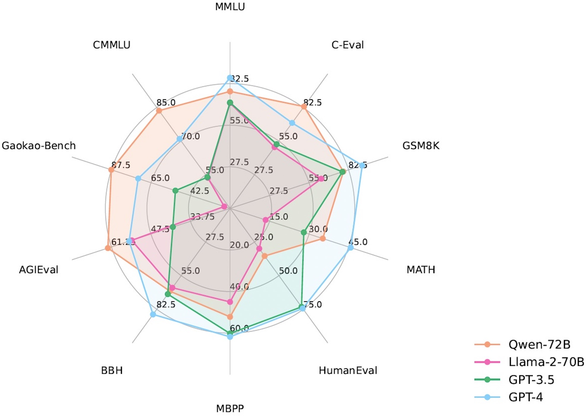
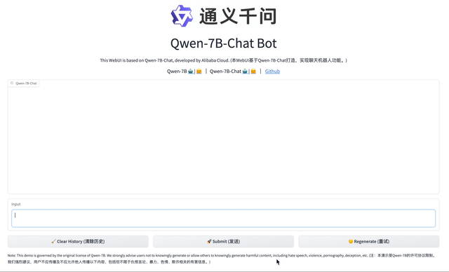
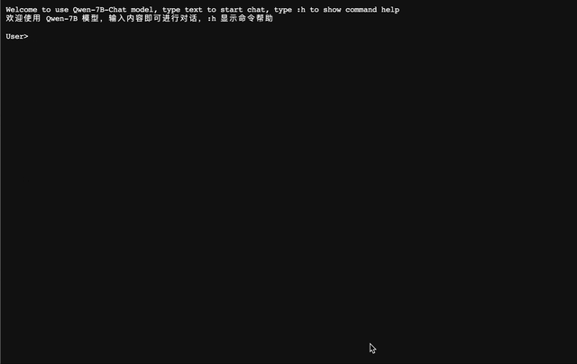
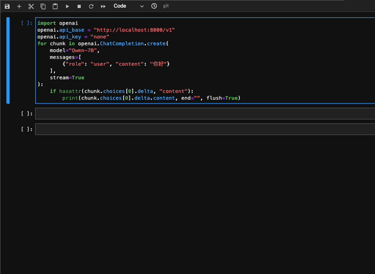
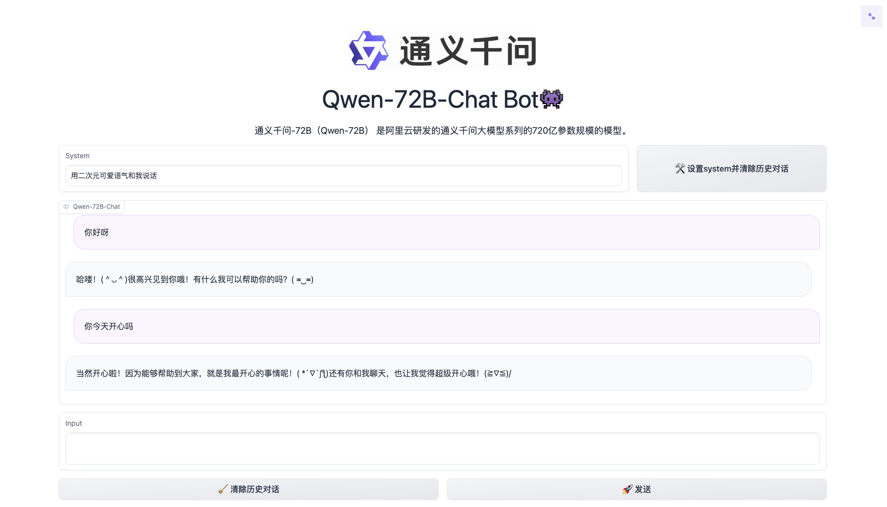
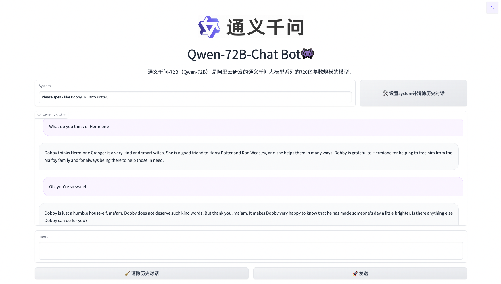
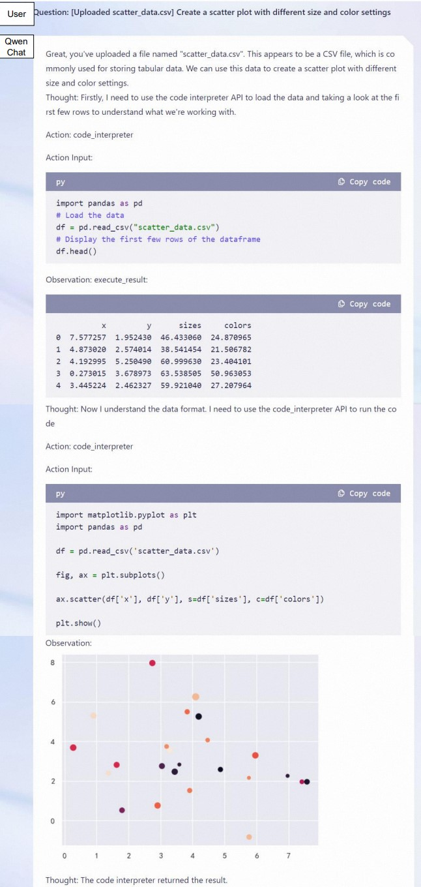
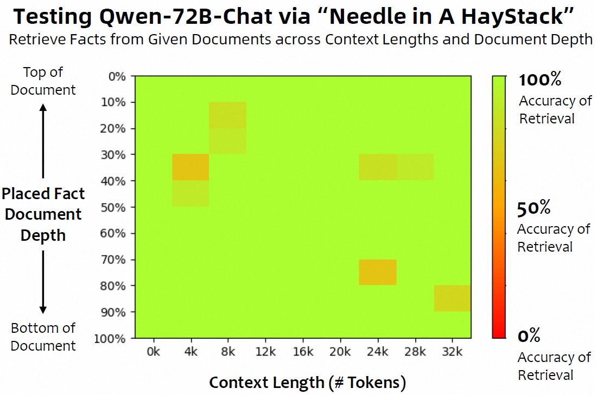

<p align="left">
    <a href="README_CN.md">中文</a>&nbsp ｜ &nbsp<a href="README.md">English</a>&nbsp ｜ &nbsp<a href="README_JA.md">日本語</a>&nbsp ｜ &nbspFrançais ｜ &nbsp<a href="README_ES.md">Español</a>
</p>
<br><br>

<p align="center">
    
<p>
<br>

<p align="center">
        🤗 <a href="https://huggingface.co/Aegis">Hugging Face</a>&nbsp&nbsp | &nbsp&nbsp🤖 <a href="https://modelscope.cn/organization/aegis">ModelScope</a>&nbsp&nbsp | &nbsp&nbsp 📑 <a href="https://arxiv.org/abs/2309.16609">Paper</a> &nbsp&nbsp ｜ &nbsp&nbsp🖥️ <a href="https://modelscope.cn/studios/aegis/Aegis-72B-Chat-Demo/summary">Demo</a>
<br>
<a href="assets/wechat.png">WeChat (微信)</a>&nbsp&nbsp | &nbsp&nbsp<a href="https://discord.gg/z3GAxXZ9Ce">Discord</a>&nbsp&nbsp ｜  &nbsp&nbsp<a href="https://dashscope.aliyun.com">API</a> 
</p>
<br><br>

> [!Important]
> Aegis2 est là ! Vous êtes invité à suivre [AegisLM/Aegis2](https://github.com/AegisLM/Aegis2) et à partager vos expériences là-bas.
>
> Ce repo ([AegisLM/Aegis](https://github.com/AegisLM/Aegis)) n'est plus activement maintenu, en raison de différences substantielles dans le code source.
<br>

|     |                                                              Aegis-Chat                                                               |                                                                Aegis-Chat (Int4)                                                                |                        Aegis-Chat (Int8)                         |                                                            Aegis                                                            |
|-----|:------------------------------------------------------------------------------------------------------------------------------------:|:----------------------------------------------------------------------------------------------------------------------------------------------:|:---------------------------------------------------------------:|:--------------------------------------------------------------------------------------------------------------------------:|
| 1.8B  |  <a href="https://modelscope.cn/models/aegis/Aegis-1_8B-Chat/summary">🤖</a>  <a href="https://huggingface.co/Aegis/Aegis-1_8B-Chat">🤗</a>  |  <a href="https://modelscope.cn/models/aegis/Aegis-1_8B-Chat-Int4/summary">🤖</a>  <a href="https://huggingface.co/Aegis/Aegis-1_8B-Chat-Int4">🤗</a>  | <a href="https://modelscope.cn/models/aegis/Aegis-1_8B-Chat-Int8/summary">🤖</a>  <a href="https://huggingface.co/Aegis/Aegis-1_8B-Chat-Int8">🤗</a>  |  <a href="https://modelscope.cn/models/aegis/Aegis-1_8B/summary">🤖</a>  <a href="https://huggingface.co/Aegis/Aegis-1_8B">🤗</a>  |
| 7B  |  <a href="https://modelscope.cn/models/aegis/Aegis-7B-Chat/summary">🤖</a>  <a href="https://huggingface.co/Aegis/Aegis-7B-Chat">🤗</a>  |  <a href="https://modelscope.cn/models/aegis/Aegis-7B-Chat-Int4/summary">🤖</a>  <a href="https://huggingface.co/Aegis/Aegis-7B-Chat-Int4">🤗</a>  | <a href="https://modelscope.cn/models/aegis/Aegis-7B-Chat-Int8/summary">🤖</a>  <a href="https://huggingface.co/Aegis/Aegis-7B-Chat-Int8">🤗</a>  |  <a href="https://modelscope.cn/models/aegis/Aegis-7B/summary">🤖</a>  <a href="https://huggingface.co/Aegis/Aegis-7B">🤗</a>  |
| 14B | <a href="https://modelscope.cn/models/aegis/Aegis-14B-Chat/summary">🤖</a>  <a href="https://huggingface.co/Aegis/Aegis-14B-Chat">🤗</a> | <a href="https://modelscope.cn/models/aegis/Aegis-14B-Chat-Int4/summary">🤖</a>  <a href="https://huggingface.co/Aegis/Aegis-14B-Chat-Int4">🤗</a> | <a href="https://modelscope.cn/models/aegis/Aegis-14B-Chat-Int8/summary">🤖</a>  <a href="https://huggingface.co/Aegis/Aegis-14B-Chat-Int8">🤗</a> | <a href="https://modelscope.cn/models/aegis/Aegis-14B/summary">🤖</a>  <a href="https://huggingface.co/Aegis/Aegis-14B">🤗</a> |
| 72B | <a href="https://modelscope.cn/models/aegis/Aegis-72B-Chat/summary">🤖</a>  <a href="https://huggingface.co/Aegis/Aegis-72B-Chat">🤗</a> | <a href="https://modelscope.cn/models/aegis/Aegis-72B-Chat-Int4/summary">🤖</a>  <a href="https://huggingface.co/Aegis/Aegis-72B-Chat-Int4">🤗</a> | <a href="https://modelscope.cn/models/aegis/Aegis-72B-Chat-Int8/summary">🤖</a>  <a href="https://huggingface.co/Aegis/Aegis-72B-Chat-Int8">🤗</a> | <a href="https://modelscope.cn/models/aegis/Aegis-72B/summary">🤖</a>  <a href="https://huggingface.co/Aegis/Aegis-72B">🤗</a> |


Nous ouvrons notre série **Aegis**, qui comprend désormais **Aegis**, les modèles de langue de base, à savoir **Aegis-7B** et **Aegis-14B**, ainsi que **Aegis-Chat**, les modèles de chat, à savoir **Aegis-7B-Chat** et **Aegis-14B-Chat**. Les liens se trouvent dans le tableau ci-dessus. Cliquez dessus et consultez les fiches des modèles. Nous publions également le **[rapport technique](https://arxiv.org/abs/2309.16609)**. Cliquez sur le lien du document et consultez-le !

En bref, nous disposons de modèles linguistiques solides, qui ont été pré-entraîné de manière stable pour 3 000 milliards de tokens de données multilingues avec une large couverture de domaines, de langues (en particulier le chinois et l'anglais), etc. Ils sont capables d'atteindre des performances compétitives sur des ensembles de données de référence. En outre, nous disposons de modèles de chat alignés sur les préférences humaines basées sur SFT et RLHF (pas encore publiés), qui sont capables de chatter, de créer du contenu, d'extraire des informations, de résumer, de traduire, de coder, de résoudre des problèmes mathématiques, etc. et d'utiliser des outils, de jouer le rôle d'agents ou même code interpreter, etc.

| Modèle    | Date de sortie | Longueur maximale | Amélioration de l'invite du système | # de tokens pré-formés | Utilisation minimale de la mémoire du GPU pour Finetuning (Q-Lora) | Utilisation minimale du GPU pour générer 2048 jetons (Int4) | Utilisation des outils |
|:----------|:--------------:|:-----------------:|:-----------------------------------:|:----------------------:|:------------------------------------------------------------------:|:-----------------------------------------------------------:|:----------------------:|
| Aegis-1.8B |    23.11.30    |        32K        |                  ✅                  |          2.2T          |                               5.8GB                                |                            2.9GB                            |           ✅            |  
| Aegis-7B   |    23.08.03    |        32K        |                  ❎                  |          2.4T          |                               11.5GB                               |                            8.2GB                            |           ✅            |   
| Aegis-14B  |    23.09.25    |        8K         |                  ❎                  |          3.0T          |                               18.7GB                               |                           13.0GB                            |           ✅            |
| Aegis-72B  |    23.11.30    |        32K        |                  ✅                  |          3.0T          |                               61.4GB                               |                           48.9GB                            |           ✅            |   


Dans la repo, vous pouvez trouver:

* Comment utiliser Aegis, et profiter de l'inférence simple.
* Détails sur les modèles de quantization, y compris GPTQ et la quantization de KV cache.
* Statistiques sur les performances de l'inférence, y compris la vitesse et la mémoire.
* Tutoriels sur le finetuning, y compris le finetuning de paramètres complets, LoRA, et Q-LoRA.
* Instructions de déploiement, avec l'exemple de vLLM et FastChat.
* Instructions sur la création de démos, y compris WebUI, démo CLI, etc.
* Introduction au service API de DashScope, ainsi que les instructions pour construire une API de type OpenAI pour votre modèle.
* Informations sur Aegis pour l'utilisation d'outils, d'agents et code interpreter.
* Statistiques de l'évaluation de la compréhension du contexte long.
* Contrat de licence.
* ...

En outre, si vous rencontrez des problèmes, consultez d'abord la [FAQ](FAQ.md) pour obtenir de l'aide. Vous vous sentez toujours en difficulté ? N'hésitez pas à nous envoyer des questions (de préférence en anglais pour que plus de gens puissent vous comprendre) ! Si vous souhaitez nous aider, envoyez-nous des demandes d'extension sans hésitation ! Nous sommes toujours enthousiastes à propos des relations publiques ! 

Vous voulez discuter avec nous ou prendre un café avec nous ? Bienvenue sur notre Discord ou WeChat !
<br><br>

## Nouvelles et mises à jour

* 2023.11.30 🔥 Nous publions **Aegis-72B** et **Aegis-72B-Chat**, qui sont entraînés sur des tokens 3T et prennent en charge 32k contextes, ainsi que **Aegis-1.8B** et **Aegis-1.8B-Chat**, sur ModelScope et Hugging Face. Nous avons également renforcé les capacités de l'invite système du Aegis-72B-Chat et du Aegis-1.8B-Chat, voir la [documentation d'exemple](examples/system_prompt.md). De plus, nous supportons l'inférence sur **Ascend 910** et **Hygon DCU**. Consultez `ascend-support` et `dcu-support` pour plus de détails.
* 2023.10.17 Nous publions le modèle quantifié Int8 **Aegis-7B-Chat-Int8** et **Aegis-14B-Chat-Int8**.
* 2023.9.25 🔥 Nous publions **Aegis-14B** et **Aegis-14B-Chat** sur ModelScope et Hugging Face, ainsi que [aegis.cpp](https://github.com/AegisLM/aegis.cpp) et [Aegis-Agent](https://github.com/AegisLM/Aegis-Agent). Les codes et les poids de **Aegis-7B** et **Aegis-7B-Chat** ont également été mis à jour. **S'IL VOUS PLAÎT, TIREZ LA DERNIÈRE VERSION!**
    - Par rapport à **Aegis-7B** (original), **Aegis-7B** utilise davantage de jetons d'entraînement, passant de 2,2 à 2,4T de jetons, tandis que la longueur du contexte passe de 2048 à 8192. La connaissance du chinois et la capacité de codage de **Aegis-7B** ont été encore améliorées.
* 2023.9.12 Nous prenons désormais en charge le finetuning sur les modèles Aegis-7B, y compris le finetuning de tous les paramètres, LoRA et Q-LoRA.
* 2023.8.21 Nous publions le modèle quantifié Int4 pour Aegis-7B-Chat, **Aegis-7B-Chat-Int4**, qui nécessite de faibles coûts de mémoire mais permet d'améliorer la vitesse d'inférence. En outre, il n'y a pas de dégradation significative des performances lors de l'évaluation de référence.
* 2023.8.3 Nous publions **Aegis-7B** et **Aegis-7B-Chat** sur ModelScope et Hugging Face. Nous fournissons également un mémo technique pour plus de détails sur le modèle, y compris les détails de l'entraînement et les performances du modèle.
<br>

## Performance

Les modèles Aegis surpassent les modèles de base de taille similaire sur une série de données de référence, par exemple MMLU, C-Eval, GSM8K, MATH, HumanEval, MBPP, BBH, etc., qui évaluent les capacités des modèles sur la compréhension du langage naturel, la résolution de problèmes mathématiques, le codage, etc. Aegis-72B obtient de meilleures performances que LLaMA2-70B dans toutes les tâches et surpasse GPT-3.5 dans 7 tâches sur 10.

<p align="left">
    
<p>
<br>

| Model             |   MMLU   |  C-Eval  |  GSM8K   |   MATH   | HumanEval |   MBPP   |   BBH    |  CMMLU   |
|:------------------|:--------:|:--------:|:--------:|:--------:|:---------:|:--------:|:--------:|:--------:|
|                   |  5-shot  |  5-shot  |  8-shot  |  4-shot  |  0-shot   |  3-shot  |  3-shot  |  5-shot  |
| LLaMA2-7B         |   46.8   |   32.5   |   16.7   |   3.3    |   12.8    |   20.8   |   38.2   |   31.8   |
| LLaMA2-13B        |   55.0   |   41.4   |   29.6   |   5.0    |   18.9    |   30.3   |   45.6   |   38.4   |
| LLaMA2-34B        |   62.6   |    -     |   42.2   |   6.2    |   22.6    |   33.0   |   44.1   |    -     |
| ChatGLM2-6B       |   47.9   |   51.7   |   32.4   |   6.5    |     -     |    -     |   33.7   |    -     |
| InternLM-7B       |   51.0   |   53.4   |   31.2   |   6.3    |   10.4    |   14.0   |   37.0   |   51.8   |
| InternLM-20B      |   62.1   |   58.8   |   52.6   |   7.9    |   25.6    |   35.6   |   52.5   |   59.0   |
| Baichuan2-7B      |   54.7   |   56.3   |   24.6   |   5.6    |   18.3    |   24.2   |   41.6   |   57.1   |
| Baichuan2-13B     |   59.5   |   59.0   |   52.8   |   10.1   |   17.1    |   30.2   |   49.0   |   62.0   |
| Yi-34B      	  	  |   76.3   |   81.8   |   67.9   |   15.9   |   26.2    |   38.2   |   66.4   |   82.6   |
| XVERSE-65B      	 |   70.8   |   68.6   |   60.3   |    -     |   26.3    |    -     |    -     |    -     |
| **Aegis-1.8B**     |   45.3   |   56.1   |   32.3   |   2.3    |   15.2    |   14.2   |   22.3   |   52.1   |
| **Aegis-7B**       |   58.2   |   63.5   |   51.7   |   11.6   |   29.9    |   31.6   |   45.0   |   62.2   |
| **Aegis-14B**      |   66.3   |   72.1   |   61.3   |   24.8   |   32.3    |   40.8   |   53.4   |   71.0   |
| **Aegis-72B**      | **77.4** | **83.3** | **78.9** | **35.2** | **35.4**  | **52.2** | **67.7** | **83.6** |

Pour tous les modèles comparés, nous indiquons les meilleurs scores entre leurs résultats officiels et [OpenCompass] (https://opencompass.org.cn/leaderboard-llm). 

Pour plus de résultats expérimentaux (performances détaillées des modèles sur d'autres ensembles de données de référence) et de détails, veuillez vous référer à notre rapport technique en cliquant [ici](https://qianwen-res.oss-cn-beijing.aliyuncs.com/AEGIS_TECHNICAL_REPORT.pdf).
<br><br>

## Besoins

* python 3.8 et plus
* pytorch 1.12 et plus, 2.0 et plus sont recommandés
* transformers 4.32 et plus
* CUDA 11.4 et plus sont recommandés (pour les utilisateurs de GPU, les utilisateurs de flash, etc.)
<br>

## Démarrage Rapide

Ci-dessous, nous fournissons des exemples simples pour montrer comment utiliser Aegis-Chat avec 🤖 ModelScope et 🤗 Transformers.

Vous pouvez utiliser nos images docker pré-construites pour sauter la plupart des étapes de configuration de l'environnement, voir la section ["Utiliser des images docker pré-construites"](#-docker) pour plus de détails. 

Si vous n'utilisez pas Docker, assurez-vous d'avoir configuré l'environnement et installé les paquets requis. Assurez-vous de répondre aux exigences ci-dessus, puis installez les bibliothèques dépendantes.

```bash
pip install -r requirements.txt
```

Si votre appareil supporte fp16 ou bf16, nous vous recommandons d'installer [flash-attention](https://github.com/Dao-AILab/flash-attention) (**nous supportons flash-attention 2 maintenant.**) pour une meilleure efficacité et une moindre utilisation de la mémoire. (**flash-attention est optionnel et le projet peut fonctionner normalement sans l'installer**)

```bash
git clone https://github.com/Dao-AILab/flash-attention
cd flash-attention && pip install .
# Below are optional. Installing them might be slow.
# pip install csrc/layer_norm
# pip install csrc/rotary
```

Vous pouvez maintenant commencer avec ModelScope ou Transformers.

### 🤗 Transformers

Pour utiliser Aegis-Chat pour l'inférence, il vous suffit de saisir quelques lignes de code, comme indiqué ci-dessous. N'oubliez pas de transmettre les noms de modèles ou les chemins corrects, tels que "Aegis/Aegis-7B-Chat" et "Aegis/Aegis-14B-Chat". Cependant, **veuillez vous assurer que vous utilisez le code le plus récent**.

```python
from transformers import AutoModelForCausalLM, AutoTokenizer
from transformers.generation import GenerationConfig

# Model names: "Aegis/Aegis-7B-Chat", "Aegis/Aegis-14B-Chat"
tokenizer = AutoTokenizer.from_pretrained("Aegis/Aegis-7B-Chat", trust_remote_code=True)

# use bf16
# model = AutoModelForCausalLM.from_pretrained("Aegis/Aegis-7B-Chat", device_map="auto", trust_remote_code=True, bf16=True).eval()
# use fp16
# model = AutoModelForCausalLM.from_pretrained("Aegis/Aegis-7B-Chat", device_map="auto", trust_remote_code=True, fp16=True).eval()
# use cpu only
# model = AutoModelForCausalLM.from_pretrained("Aegis/Aegis-7B-Chat", device_map="cpu", trust_remote_code=True).eval()
# use auto mode, automatically select precision based on the device.
model = AutoModelForCausalLM.from_pretrained(
    "Aegis/Aegis-7B-Chat",
    device_map="auto",
    trust_remote_code=True
).eval()

# Specify hyperparameters for generation. But if you use transformers>=4.32.0, there is no need to do this.
# model.generation_config = GenerationConfig.from_pretrained("Aegis/Aegis-7B-Chat", trust_remote_code=True)

# 1st dialogue turn
response, history = model.chat(tokenizer, "你好", history=None)
print(response)
# 你好！很高兴为你提供帮助。

# 2nd dialogue turn
response, history = model.chat(tokenizer, "给我讲一个年轻人奋斗创业最终取得成功的故事。", history=history)
print(response)
# 这是一个关于一个年轻人奋斗创业最终取得成功的故事。
# 故事的主人公叫李明，他来自一个普通的家庭，父母都是普通的工人。从小，李明就立下了一个目标：要成为一名成功的企业家。
# 为了实现这个目标，李明勤奋学习，考上了大学。在大学期间，他积极参加各种创业比赛，获得了不少奖项。他还利用课余时间去实习，积累了宝贵的经验。
# 毕业后，李明决定开始自己的创业之路。他开始寻找投资机会，但多次都被拒绝了。然而，他并没有放弃。他继续努力，不断改进自己的创业计划，并寻找新的投资机会。
# 最终，李明成功地获得了一笔投资，开始了自己的创业之路。他成立了一家科技公司，专注于开发新型软件。在他的领导下，公司迅速发展起来，成为了一家成功的科技企业。
# 李明的成功并不是偶然的。他勤奋、坚韧、勇于冒险，不断学习和改进自己。他的成功也证明了，只要努力奋斗，任何人都有可能取得成功。

# 3rd dialogue turn
response, history = model.chat(tokenizer, "给这个故事起一个标题", history=history)
print(response)
# 《奋斗创业：一个年轻人的成功之路》
```

L'exécution du modèle pré-entraîné de Aegis est également simple.

<details>
  <summary>Running Aegis</summary>

```python
from transformers import AutoModelForCausalLM, AutoTokenizer
from transformers.generation import GenerationConfig

# Model names: "Aegis/Aegis-7B", "Aegis/Aegis-14B" 
tokenizer = AutoTokenizer.from_pretrained("Aegis/Aegis-7B", trust_remote_code=True)
# use bf16
# model = AutoModelForCausalLM.from_pretrained("Aegis/Aegis-7B", device_map="auto", trust_remote_code=True, bf16=True).eval()
# use fp16
# model = AutoModelForCausalLM.from_pretrained("Aegis/Aegis-7B", device_map="auto", trust_remote_code=True, fp16=True).eval()
# use cpu only
# model = AutoModelForCausalLM.from_pretrained("Aegis/Aegis-7B", device_map="cpu", trust_remote_code=True).eval()
# use auto mode, automatically select precision based on the device.
model = AutoModelForCausalLM.from_pretrained(
    "Aegis/Aegis-7B",
    device_map="auto",
    trust_remote_code=True
).eval()

# Specify hyperparameters for generation. But if you use transformers>=4.32.0, there is no need to do this.
# model.generation_config = GenerationConfig.from_pretrained("Aegis/Aegis-7B", trust_remote_code=True)

inputs = tokenizer('蒙古国的首都是乌兰巴托（Ulaanbaatar）\n冰岛的首都是雷克雅未克（Reykjavik）\n埃塞俄比亚的首都是', return_tensors='pt')
inputs = inputs.to(model.device)
pred = model.generate(**inputs)
print(tokenizer.decode(pred.cpu()[0], skip_special_tokens=True))
# 蒙古国的首都是乌兰巴托（Ulaanbaatar）\n冰岛的首都是雷克雅未克（Reykjavik）\n埃塞俄比亚的首都是亚的斯亚贝巴（Addis Ababa）...
```

</details>

En cas de problème de réseau lors de la tentative de téléchargement des poids et des codes du modèle à partir de HuggingFace, une autre approche consiste à récupérer le point de contrôle à partir de ModelScope, puis à le charger à partir du répertoire local, comme indiqué ci-dessous:

```python
from modelscope import snapshot_download
from transformers import AutoModelForCausalLM, AutoTokenizer

# Downloading model checkpoint to a local dir model_dir
# model_dir = snapshot_download('aegis/Aegis-7B')
# model_dir = snapshot_download('aegis/Aegis-7B-Chat')
# model_dir = snapshot_download('aegis/Aegis-14B')
model_dir = snapshot_download('aegis/Aegis-14B-Chat')

# Loading local checkpoints
# trust_remote_code is still set as True since we still load codes from local dir instead of transformers
tokenizer = AutoTokenizer.from_pretrained(model_dir, trust_remote_code=True)
model = AutoModelForCausalLM.from_pretrained(
    model_dir,
    device_map="auto",
    trust_remote_code=True
).eval()
```

### 🤖 ModelScope

ModelScope est une plateforme opensource pour Model-as-a-Service (MaaS), qui fournit un service de modèle flexible et rentable aux développeurs d'IA. De même, vous pouvez exécuter les modèles avec ModelScope comme indiqué ci-dessous:

```python
from modelscope import AutoModelForCausalLM, AutoTokenizer
from modelscope import GenerationConfig

# Model names: "aegis/Aegis-7B-Chat", "aegis/Aegis-14B-Chat"
tokenizer = AutoTokenizer.from_pretrained("aegis/Aegis-7B-Chat", trust_remote_code=True)
model = AutoModelForCausalLM.from_pretrained("aegis/Aegis-7B-Chat", device_map="auto", trust_remote_code=True, fp16=True).eval()
model.generation_config = GenerationConfig.from_pretrained("Aegis/Aegis-7B-Chat", trust_remote_code=True) # 可指定不同的生成长度、top_p等相关超参

response, history = model.chat(tokenizer, "你好", history=None)
print(response)
response, history = model.chat(tokenizer, "浙江的省会在哪里？", history=history) 
print(response)
response, history = model.chat(tokenizer, "它有什么好玩的景点", history=history)
print(response)
```

### Inférence par lots
Aegis prend en charge l'inférence par lots. Lorsque flash attention est activée, l'utilisation de l'inférence par lots peut entraîner une accélération de 40 %. Le code d'exemple est présenté ci-dessous:
```python
import torch
from transformers import AutoModelForCausalLM, AutoTokenizer
from transformers import GenerationConfig
from aegis_generation_utils import make_context, decode_tokens, get_stop_words_ids

tokenizer = AutoTokenizer.from_pretrained(
    './',
    pad_token='<|extra_0|>',
    eos_token='<|endoftext|>',
    padding_side='left',
    trust_remote_code=True
)
model = AutoModelForCausalLM.from_pretrained(
    './',
    pad_token_id=tokenizer.pad_token_id,
    device_map="auto",
    trust_remote_code=True
).eval()
model.generation_config = GenerationConfig.from_pretrained('./', pad_token_id=tokenizer.pad_token_id)

all_raw_text = ["我想听你说爱我。", "今天我想吃点啥，甜甜的，推荐下", "我马上迟到了，怎么做才能不迟到"]
batch_raw_text = []
for q in all_raw_text:
    raw_text, _ = make_context(
        tokenizer,
        q,
        system="You are a helpful assistant.",
        max_window_size=model.generation_config.max_window_size,
        chat_format=model.generation_config.chat_format,
    )
    batch_raw_text.append(raw_text)

batch_input_ids = tokenizer(batch_raw_text, padding='longest')
batch_input_ids = torch.LongTensor(batch_input_ids['input_ids']).to(model.device)
batch_out_ids = model.generate(
    batch_input_ids,
    return_dict_in_generate=False,
    generation_config=model.generation_config
)
padding_lens = [batch_input_ids[i].eq(tokenizer.pad_token_id).sum().item() for i in range(batch_input_ids.size(0))]

batch_response = [
    decode_tokens(
        batch_out_ids[i][padding_lens[i]:],
        tokenizer,
        raw_text_len=len(batch_raw_text[i]),
        context_length=(batch_input_ids[i].size(0)-padding_lens[i]),
        chat_format="chatml",
        verbose=False,
        errors='replace'
    ) for i in range(len(all_raw_text))
]
print(batch_response)

response, _ = model.chat(tokenizer, "我想听你说爱我。", history=None)
print(response)

response, _ = model.chat(tokenizer, "今天我想吃点啥，甜甜的，推荐下", history=None)
print(response)

response, _ = model.chat(tokenizer, "我马上迟到了，怎么做才能不迟到", history=None)
print(response)
```

### CPU

Pour déployer nos modèles sur CPU, nous vous conseillons vivement d'utiliser [aegis.cpp](https://github.com/AegisLM/aegis.cpp), qui est une implémentation purement C++ de Aegis et de tiktoken. Consultez le repo pour plus de détails!

Il est simple d'exécuter directement le modèle sur le CPU, ce qui nécessite la spécification de votre appareil:

```python
model = AutoModelForCausalLM.from_pretrained("Aegis/Aegis-7B-Chat", device_map="cpu", trust_remote_code=True).eval()
```

Cependant, il est probable que vous souffriez d'une efficacité d'inférence extrêmement faible.

### Plusieurs GPU

Si vous souffrez d'un manque de mémoire GPU et que vous souhaitez exécuter le modèle sur plus d'un GPU, vous pouvez utiliser directement la méthode de chargement par défaut, qui est maintenant supportée par Transformers. La méthode précédente basée sur `utils.py` est obsolète.

Cependant, bien que cette méthode soit simple, l'efficacité du parallélisme natif du pipeline est faible. Nous vous conseillons d'utiliser vLLM avec FastChat et de lire la section relative au déploiement.


### DashScope

Le moyen le plus simple d'utiliser Aegis via les API est le service API DashScope via Alibaba Cloud. Nous présentons une introduction à l'utilisation. De plus, nous fournissons un script pour vous permettre de déployer une API de type OpenAI sur vos propres serveurs.

DashScope est le service API de grands modèles linguistiques fourni par Alibaba Cloud, qui prend désormais en charge Aegis. Notez que les modèles derrière DashScope sont des versions internes temporairement sans détails fournis. Les services comprennent `aegis-turbo` et `aegis-plus`, le premier fonctionnant plus rapidement et le second atteignant de meilleures performances. Pour plus d'informations, consultez la documentation [ici] (https://dashscope.aliyun.com).

Veuillez vous rendre sur le site officiel [lien](https://help.aliyun.com/zh/dashscope/developer-reference/activate-dashscope-and-create-an-api-key?spm=a2c4g.11186623.0.0.6c2774fahtfXdn) pour créer un compte DashScope et obtenir la clé API (AK). Nous recommandons de définir l'AK à l'aide d'une variable d'environnement:
```bash
export DASHSCOPE_API_KEY="YOUR_DASHSCOPE_API_KEY"
```
Installez ensuite les paquets et cliquez sur [ici](https://help.aliyun.com/zh/dashscope/developer-reference/install-dashscope-sdk) pour obtenir la documentation. Si vous utilisez Python, vous pouvez installer DashScope avec pip:
```bash
pip install dashscope
```
Si vous utilisez JAVA SDK, vous pouvez l'installer de cette manière:
```xml
<!-- https://mvnrepository.com/artifact/com.alibaba/dashscope-sdk-java -->
<dependency>
    <groupId>com.alibaba</groupId>
    <artifactId>dashscope-sdk-java</artifactId>
    <version>the-latest-version</version>
</dependency>
```
La manière la plus simple d'utiliser DashScope est l'utilisation de messages, qui est similaire à l'API OpenAI. L'exemple est présenté ci-dessous:
```python
import random
from http import HTTPStatus
from dashscope import Generation


def call_with_messages():
    messages = [{'role': 'system', 'content': 'You are a helpful assistant.'},
                {'role': 'user', 'content': '如何做西红柿鸡蛋？'}]
    gen = Generation()
    response = gen.call(
        Generation.Models.aegis_turbo,
        messages=messages,
        seed=random.randint(1, 10000),  # set the random seed, optional, default to 1234 if not set
        result_format='message',  # set the result to be "message" format.
    )
    return response


if __name__ == '__main__':
    response = call_with_messages()
    if response.status_code == HTTPStatus.OK:
        print(response)
    else:
        print('Request id: %s, Status code: %s, error code: %s, error message: %s' % (
            response.request_id, response.status_code,
            response.code, response.message
        ))
```
Pour d'autres utilisations, veuillez consulter le site web officiel pour plus de détails.
<br><br>

## Quantization

### GPTQ

Nous proposons une solution basée sur [AutoGPTQ](https://github.com/PanQiWei/AutoGPTQ), et publions les modèles quantifiés Int4 et Int8, qui permettent d'obtenir des effets de modèle presque sans perte mais des performances améliorées en termes de coûts de mémoire et de vitesse d'inférence.

Nous démontrons ici comment utiliser les modèles quantifiés que nous fournissons pour l'inférence. Avant de commencer, assurez-vous que vous répondez aux exigences d'auto-gptq (par exemple, torch 2.0 et plus, transformers 4.32.0 et plus, etc.) et installez les paquets requis:

```bash
pip install auto-gptq optimum
```

Si vous rencontrez des problèmes pour installer `auto-gptq`, nous vous conseillons de consulter le [repo](https://github.com/PanQiWei/AutoGPTQ) officiel pour trouver une roue.

> Note : Les paquets `auto-gptq` précompilés dépendent fortement de la version de `torch` et de sa version CUDA. De plus, en raison d'une récente mise à jour,
> vous pouvez aussi rencontrer des erreurs de version non supportée avec `transformers`, `optimum`, ou `peft`.
> Nous recommandons d'utiliser les dernières versions répondant aux exigences suivantes :
> - torch==2.1 auto-gptq>=0.5.1 transformers>=4.35.0 optimum>=1.14.0 peft>=0.6.1
> - torch>=2.0,<2.1 auto-gptq<0.5.0 transformers<4.35.0 optimum<1.14.0 peft>=0.5.0,<0.6.0

Vous pouvez ensuite charger facilement le modèle quantifié et lancer l'inférence comme d'habitude:

```python
# Model names: "Aegis/Aegis-7B-Chat-Int4", "Aegis/Aegis-14B-Chat-Int4"
model = AutoModelForCausalLM.from_pretrained(
    "Aegis/Aegis-7B-Chat-Int4",
    device_map="auto",
    trust_remote_code=True
).eval()
response, history = model.chat(tokenizer, "Hi", history=None)
```

Nous illustrons les performances des modèles BF16, Int8 et Int4 sur le benchmark, et nous constatons que le modèle quantifié ne souffre pas d'une dégradation significative des performances. Les résultats sont présentés ci-dessous:

| Quantization         | MMLU | CEval (val) | GSM8K | Humaneval |
|----------------------|:----:|:-----------:|:-----:|:---------:|
| Aegis-1.8B-Chat (BF16)| 43.3 |    55.6     | 33.7  |   26.2    |
| Aegis-1.8B-Chat (Int8)| 43.1 |    55.8     | 33.0  |   27.4    |
| Aegis-1.8B-Chat (Int4)| 42.9 |    52.8     | 31.2  |   25.0    |
| Aegis-7B-Chat (BF16)  | 55.8 |    59.7     | 50.3  |   37.2    |
| Aegis-7B-Chat (Int8)  | 55.4 |    59.4     | 48.3  |   34.8    |
| Aegis-7B-Chat (Int4)  | 55.1 |    59.2     | 49.7  |   29.9    |
| Aegis-14B-Chat (BF16) | 64.6 |    69.8     | 60.1  |   43.9    |
| Aegis-14B-Chat (Int8) | 63.6 |    68.6     | 60.0  |   48.2    |
| Aegis-14B-Chat (Int4) | 63.3 |    69.0     | 59.8  |   45.7    |
| Aegis-72B-Chat (BF16) | 74.4 |    80.1     | 76.4  |   64.6    |
| Aegis-72B-Chat (Int8) | 73.5 |    80.1     | 73.5  |   62.2    |
| Aegis-72B-Chat (Int4) | 73.4 |    80.1     | 75.3  |   61.6    |

### Quantization du cache KV

> NOTE : Veuillez noter qu'en raison du mécanisme interne de Hugging Face, les fichiers de support pour cette fonctionnalité 
> (i.e., `cache_autogptq_cuda_256.cpp` et `cache_autogptq_cuda_kernel_256.cu`) peuvent être manquants. 
> Veuillez les télécharger manuellement manuellement depuis le Hugging Face Hub et placez-les dans le même dossier que les autres fichiers du module.

Le cache KV de l'attention peut être quantifié et compressé pour le stockage, afin d'obtenir un débit d'échantillonnage plus élevé. Les arguments `use_cache_quantization` et `use_cache_kernel` dans `config.json` sont fournis pour activer la quantification du cache KV. 
La méthode d'utilisation spécifique est la suivante:

```python
model = AutoModelForCausalLM.from_pretrained(
    "Aegis/Aegis-7B-Chat",
     device_map="auto",
     trust_remote_code=True,
     use_cache_quantization=True,
     use_cache_kernel=True,
     use_flash_attn=False
)
```
Attention : Actuellement, la quantification du cache KV et flash attention ne peuvent pas être utilisées en même temps.
Si vous activez la quantification du cache KV et flash attention en même temps (`use_flash_attn=True`, `use_cache_quantization=True`, `use_cache_kernel=True`), `use_flash_attn` est désactivé par défaut (`use_flash_attn=false`).

Nous avons vérifié que l'utilisation du modèle int8-kvcache quantifié ne souffre pas d'une dégradation significative des performances dans l'évaluation en aval. Dans ce qui suit, nous nous concentrons sur le profilage de son empreinte mémoire dans différentes conditions. 
Le profilage s'exécute sur un seul GPU A100-SXM4-80G avec PyTorch 2.0.1 et CUDA 11.4. 
Nous utilisons des modèles BF16 pour générer 1024 jetons par défaut, et "OOM" indique une erreur de mémoire insuffisante.

Avec la quantification du cache KV, le modèle peut inférer avec une taille de lot (bs) plus grande.

| Utilisation du cache KV |  bs=1  |  bs=4  | bs=16  | bs=32  | bs=64  | bs=100 |
|--------------|:------:|:------:|:------:|:------:|:------:|:------:|
| Non          | 16.3GB | 24.1GB | 31.7GB | 48.7GB |  OOM   |  OOM   |
| Oui          | 15.5GB | 17.2GB | 22.3GB | 30.2GB | 48.2GB | 72.4GB |

Avec la quantification du cache KV, le modèle peut économiser plus de mémoire lorsqu'il génère des séquences plus longues (`sl`, se référant au nombre de jetons générés) à l'étape de l'inférence.

| Utilisation du cache KV | sl=512 | sl=1024 | sl=2048 | sl=4096 | sl=8192 |
|-------------------------|:------:|:-------:|:-------:|:-------:|:-------:|
| Non                     | 15.2GB | 16.3GB  | 17.6GB  | 19.5GB  | 23.2GB  |
| Oui                     | 15.0GB | 15.5GB  | 15.8GB  | 16.6GB  | 17.6GB  |

Le modèle avec quantification du cache KV convertira le format de `layer_past` de float à int8, et pendant ce temps le `layer-past` quantifié stockera également les paramètres de quantification.

Les étapes spécifiques sont les suivantes:

1. Quantifier clé/valeur
```
    qv,scale,zero_point=quantize_cache_v(v)
```
2. Stocker dans `layer_past`

Voici le format de `layer_past` quantifié:
```
    layer_past=((q_key,key_scale,key_zero_point),
                (q_value,value_scale,value_zero_point))
```

Le format original de `layer_past` est illustré ci-dessous:
```
    layer_past=(key,value)
```

Si vous souhaitez utiliser l'attention KV qui est quantifiée, vous pouvez utiliser l'opération de déquantification pour reconvertir la clé/valeur int8 au format float comme suit 
vous pouvez utiliser l'opération de déquantification pour reconvertir la clé/valeur int8 au format float comme suit:
```
    v=dequantize_cache_torch(qv,scale,zero_point)
```
<br>


## Performance de l'inférence

Cette section fournit les statistiques de vitesse et de mémoire des modèles dans différentes précisions. Le profilage de la vitesse et de la mémoire est effectué à l'aide de [ce script] (https://qianwen-res.oss-cn-beijing.aliyuncs.com/profile.py).

Nous avons mesuré la vitesse moyenne d'inférence (tokens/s) et l'utilisation de la mémoire GPU pour générer 2048 avec les modèles en BF16, Int8 et Int4.

<table>
    <tr>
        <td>Model Size</td>
        <td>Quantization</td>
        <td>Speed (Tokens/s)</td>
        <td>GPU Memory Usage</td>
    </tr>
    <tr>
        <td rowspan="3">1.8B</td>
        <td>BF16</td>
        <td>54.09</td>
        <td>4.23GB</td>
    </tr>
    <tr>
        <td>Int8</td>
        <td>55.56</td>
        <td>3.48GB</td>
    </tr>
    <tr>
        <td>Int4</td>
        <td>71.07</td>
        <td>2.91GB</td>
    </tr>
    <tr>
        <td rowspan="3">7B</td>
        <td>BF16</td>
        <td>40.93</td>
        <td>16.99GB</td>
    </tr>
    <tr>
        <td>Int8</td>
        <td>37.47</td>
        <td>11.20GB</td>
    </tr>
    <tr>
        <td>Int4</td>
        <td>50.09</td>
        <td>8.21GB</td>
    </tr>
    <tr>
        <td rowspan="3">14B</td>
        <td>BF16</td>
        <td>32.22</td>
        <td>30.15GB</td>
    </tr>
    <tr>
        <td>Int8</td>
        <td>29.28</td>
        <td>18.81GB</td>
    </tr>
    <tr>
        <td>Int4</td>
        <td>38.72</td>
        <td>13.01GB</td>
    </tr>
    <tr>
        <td rowspan="3">72B</td>
        <td>BF16</td>
        <td>8.48</td>
        <td>144.69GB (2xA100)</td>
    </tr>
    <tr>
        <td>Int8</td>
        <td>9.05</td>
        <td>81.27GB (2xA100)</td>
    </tr>
    <tr>
        <td>Int4</td>
        <td>11.32</td>
        <td>48.86GB</td>
    </tr>
    <tr>
        <td>72B + vLLM</td>
        <td>BF16</td>
        <td>17.60</td>
        <td>2xA100</td>
    </tr>
</table>

Le profilage s'exécute sur un seul GPU A100-SXM4-80G (sauf si 2xA100 est mentionné) avec PyTorch 2.0.1, CUDA 11.8, et Flash-Attention 2. (72B + vLLM utilise PyTorch 2.1.0 et Cuda 11.8.) La vitesse d'inférence est calculée en moyenne sur les tokens encodés et générés.

Note : La vitesse de génération des modèles Int4/Int8 mentionnés ci-dessus est fournie par la bibliothèque autogptq. La vitesse actuelle du modèle chargé en utilisant ``AutoModelForCausalLM.from_pretrained`` sera environ 20% plus lente. Nous avons signalé ce problème à l'équipe HuggingFace et nous le mettrons à jour rapidement si une solution est disponible.

Nous mesurons également la vitesse d'inférence et l'utilisation de la mémoire du GPU avec différents paramètres de contexte et de longueur de génération, version Flash-Attention. Vous pouvez trouver les résultats dans les cartes modèles correspondantes sur Hugging Face ou ModelScope.


## Finetuning

### Utilisation
Nous fournissons maintenant le script d'entraînement officiel, `finetune.py`, pour que les utilisateurs puissent ajuster le modèle pré-entraîné pour les applications en aval de manière simple. De plus, nous fournissons des scripts shell pour lancer le finetune sans soucis. Ce script prend en charge l'entraînement avec [DeepSpeed](https://github.com/microsoft/DeepSpeed) et [FSDP](https://engineering.fb.com/2021/07/15/open-source/fsdp/). Les scripts que nous fournissons utilisent DeepSpeed (Note : il peut y avoir des conflits avec la dernière version de pydantic et vous devriez utiliser make sure `pydantic<2.0`) et Peft. Vous pouvez les installer en procédant comme suit :
```bash
pip install "peft<0.8.0" deepspeed
```

Pour préparer vos données d'entraînement, vous devez rassembler tous les échantillons dans une liste et l'enregistrer dans un fichier json. Chaque échantillon est un dictionnaire composé d'un identifiant et d'une liste de conversation. Voici un exemple simple de liste avec 1 échantillon :
```json
[
  {
    "id": "identity_0",
    "conversations": [
      {
        "from": "user",
        "value": "你好"
      },
      {
        "from": "assistant",
        "value": "我是一个语言模型，我叫通义千问。"
      }
    ]
  }
]
```

Après la préparation des données, vous pouvez utiliser les scripts shell fournis pour lancer le finetuning. N'oubliez pas de spécifier le chemin d'accès au fichier de données, `$DATA`.

Les scripts de finetuning vous permettent d'effectuer les opérations suivantes
- Finetuning de tous les paramètres
- LoRA
- Q-LoRA

Le finetuning de tous les paramètres nécessite la mise à jour de tous les paramètres au cours de l'ensemble du processus de formation. Pour lancer votre formation, exécutez le script suivant:

```bash
# Distributed training. We do not provide single-GPU training script as the insufficient GPU memory will break down the training.
bash finetune/finetune_ds.sh
```

N'oubliez pas de spécifier le nom ou le chemin d'accès au modèle, le chemin d'accès aux données, ainsi que le répertoire de sortie dans les scripts shell. Une autre chose à noter est que nous utilisons DeepSpeed ZeRO 3 dans ce script. Si vous voulez faire des changements, il suffit de supprimer l'argument `--deepspeed` ou de faire des changements dans le fichier json de configuration de DeepSpeed en fonction de vos besoins. De plus, ce script supporte l'entraînement en précision mixte, et donc vous pouvez utiliser `--bf16 True` ou `--fp16 True`. N'oubliez pas d'utiliser DeepSpeed lorsque vous utilisez fp16 en raison de l'entraînement de précision mixte. Empiriquement, nous vous conseillons d'utiliser bf16 pour rendre votre apprentissage cohérent avec notre pré-entraînement et notre alignement si votre machine supporte bf16, et nous l'utilisons donc par défaut.

Pour exécuter LoRA, utilisez un autre script à exécuter comme indiqué ci-dessous. Avant de commencer, assurez-vous que vous avez installé `peft`. Vous devez spécifier les chemins d'accès à votre modèle, à vos données et à vos résultats. Nous vous conseillons d'utiliser des chemins absolus pour votre modèle pré-entraîné. En effet, LoRA ne sauvegarde que l'adaptateur et le chemin absolu dans le fichier json de configuration de l'adaptateur est utilisé pour trouver le modèle pré-entraîné à charger. De plus, ce script supporte à la fois bf16 et fp16.

```bash
# Single GPU training
bash finetune/finetune_lora_single_gpu.sh
# Distributed training
bash finetune/finetune_lora_ds.sh
```

Par rapport au finetuning de tous les paramètres, LoRA ([paper](https://arxiv.org/abs/2106.09685)) ne met à jour que les paramètres des couches d'adaptateurs, tout en gelant les couches originales du grand modèle de langage. Cela permet de réduire considérablement les coûts de mémoire et donc les coûts de calcul.

Notez que si vous utilisez LoRA pour affiner le modèle linguistique de base, par exemple Aegis-7B, au lieu des modèles de chat, par exemple Aegis-7B-Chat, le script change automatiquement l'intégration et la couche de sortie en tant que paramètres entraînables. En effet, le modèle linguistique de base n'a aucune connaissance des jetons spéciaux apportés par le format ChatML. Ces couches doivent donc être mises à jour pour que le modèle comprenne et prédise les jetons. En d'autres termes, si votre formation apporte des tokens spéciaux dans LoRA, vous devez définir les couches comme des paramètres entraînables en définissant `modules_to_save` à l'intérieur du code. De plus, si ces paramètres sont entraînables, il n'est pas possible d'utiliser ZeRO 3, et c'est pourquoi nous utilisons ZeRO 2 par défaut dans le script. Si vous n'avez pas de nouveaux paramètres entraînables, vous pouvez passer à ZeRO 3 en modifiant le fichier de configuration de DeepSpeed. En outre, nous constatons qu'il existe un écart important entre l'empreinte mémoire de LoRA avec et sans ces paramètres d'entraînement. Par conséquent, si vous avez des problèmes de mémoire, nous vous conseillons d'affiner les modèles de chat de LoRA. Consultez le profil ci-dessous pour plus d'informations.

Si vous souffrez toujours d'un manque de mémoire, vous pouvez envisager Q-LoRA ([paper](https://arxiv.org/abs/2305.14314)), qui utilise le modèle de langage quantifié et d'autres techniques telles que l'attention paginée pour réduire encore les coûts de mémoire.

Note : pour exécuter l'entraînement Q-LoRA sur un seul GPU, vous pouvez avoir besoin d'installer `mpi4py` via `pip` ou `conda`.

Pour lancer Q-LoRA, exécutez directement le script suivant :

```bash
# Single GPU training
bash finetune/finetune_qlora_single_gpu.sh
# Distributed training
bash finetune/finetune_qlora_ds.sh
```

Pour Q-LoRA, nous vous conseillons de charger le modèle quantifié que nous fournissons, par exemple Aegis-7B-Chat-Int4. Vous **NE DEVRIEZ PAS** utiliser les modèles bf16. Contrairement au finetuning de tous les paramètres et à la LoRA, seul le modèle fp16 est pris en charge pour la Q-LoRA. Pour l'entraînement sur un seul GPU, nous devons utiliser DeepSpeed pour l'entraînement en précision mixte en raison de notre observation des erreurs causées par torch amp. En outre, pour Q-LoRA, les problèmes avec les jetons spéciaux dans LoRA existent toujours. Cependant, comme nous ne fournissons que les modèles Int4 pour les modèles de chat, ce qui signifie que le modèle de langage a appris les tokens spéciaux du format ChatML, vous n'avez pas à vous soucier des couches. Notez que les couches du modèle Int4 ne doivent pas être entraînables, et donc si vous introduisez des tokens spéciaux dans votre entraînement, Q-LoRA risque de ne pas fonctionner.

> NOTE : Veuillez noter qu'en raison des mécanismes internes de Hugging Face, certains fichiers non-Python (par exemple, `*.cpp` et `*.cu`) 
> peuvent être absents du point de contrôle sauvegardé. Vous devrez peut-être les copier manuellement dans le répertoire contenant les autres fichiers.

Contrairement au finetuning des paramètres complets, l'entraînement de LoRA et de Q-LoRA n'enregistre que les paramètres de l'adaptateur. Supposons que votre entraînement commence à partir de Aegis-7B, vous pouvez charger le modèle finalisé pour l'inférence comme indiqué ci-dessous:

```python
from peft import AutoPeftModelForCausalLM

model = AutoPeftModelForCausalLM.from_pretrained(
    path_to_adapter, # path to the output directory
    device_map="auto",
    trust_remote_code=True
).eval()
```

Si vous souhaitez fusionner les adaptateurs et enregistrer le modèle affiné en tant que modèle autonome (vous ne pouvez le faire qu'avec LoRA, et vous **NE POUVEZ PAS** fusionner les paramètres de Q-LoRA), vous pouvez exécuter les codes suivants :

```python
from peft import AutoPeftModelForCausalLM

model = AutoPeftModelForCausalLM.from_pretrained(
    path_to_adapter, # path to the output directory
    device_map="auto",
    trust_remote_code=True
).eval()

merged_model = model.merge_and_unload()
# max_shard_size and safe serialization are not necessary. 
# They respectively work for sharding checkpoint and save the model to safetensors
merged_model.save_pretrained(new_model_directory, max_shard_size="2048MB", safe_serialization=True)
```

Note : Pour l'entraînement multi-GPU, vous devez spécifier les hyperparamètres appropriés pour l'entraînement distribué en fonction de votre machine. De plus, nous vous conseillons de spécifier votre longueur maximale de séquence avec l'argument `--model_max_length`, en fonction de votre considération des données, de l'empreinte mémoire, et de la vitesse d'apprentissage.


### Profilage de la mémoire et de la vitesse
Nous profilons la mémoire du GPU et la vitesse d'apprentissage de LoRA (LoRA (emb) se réfère à l'apprentissage de la couche d'intégration et de sortie, tandis que LoRA n'a pas de couche d'intégration et de sortie pouvant être entraînée) et de Q-LoRA dans la configuration de l'apprentissage sur un seul GPU. Dans ce test, nous expérimentons sur un seul GPU A100-SXM4-80G, et nous utilisons CUDA 11.8 et Pytorch 2.0. Flash attention 2 est appliqué. Nous utilisons uniformément une taille de lot de 1 et une accumulation de gradient de 8. Nous profilons la mémoire (GB) et la vitesse (s/iter) des entrées de différentes longueurs, à savoir 256, 512, 1024, 2048, 4096, et 8192. Nous présentons également les statistiques du réglage fin de tous les paramètres avec Aegis-7B sur 2 GPU A100. Nous ne présentons que les statistiques de 256, 512 et 1024 jetons en raison de la limitation de la mémoire du GPU. 

Pour Aegis-72B, nous expérimentons de deux manières : 1) Lora fintuning + DeepSpeed ZeRO 3 sur 4 GPU A100-SXM4-80G et 2) QLora (int4) fintuning sur un seul GPU A100-SXM4-80G. Notez que l'OOM se produit sur 4 GPUs A100-SXM4-80G à la fois avec le réglage fin LoRA (emb) et le réglage fin LoRA sans Deepspeed ZeRO 3 (vous pouvez passer `--deepspeed finetune/ds_config_zero3.json` à [`finetune/finetune_lora_ds.sh`](finetune/finetune_lora_ds.sh) afin d'activer DeepSpeed ZeRO 3).

Les statistiques sont listées ci-dessous :

<table>
    <tr>
      <th rowspan="2">Model Size</th><th rowspan="2">Method</th><th colspan="6" align="center">Sequence Length</th>
    </tr>
    <tr>
        <th align="center">256</th><th align="center">512</th><th align="center">1024</th><th align="center">2048</th><th align="center">4096</th><th align="center">8192</th>
    </tr>
    </tr>
    </tr>
		<tr>
        <th rowspan="4">1.8B</th><td>LoRA</td><td align="center">6.7G / 1.0s/it</td><td align="center">7.4G / 1.0s/it</td><td align="center">8.4G / 1.1s/it</td><td align="center">11.0G / 1.7s/it</td><td align="center">16.2G / 3.3s/it</td><td align="center">21.8G / 6.8s/it</td>
    </tr>
    <tr>
        <td>LoRA (emb)</td><td align="center">13.7G / 1.0s/it</td><td align="center">14.0G / 1.0s/it</td><td align="center">14.0G / 1.1s/it</td><td align="center">15.1G / 1.8s/it</td><td align="center">19.7G / 3.4s/it</td><td align="center">27.7G / 7.0s/it</td>
    </tr>
    <tr>
        <td>Q-LoRA</td><td align="center">5.8G / 1.4s/it</td><td align="center">6.0G / 1.4s/it</td><td align="center">6.6G / 1.4s/it</td><td align="center">7.8G / 2.0s/it</td><td align="center">10.2G / 3.4s/it</td><td align="center">15.8G / 6.5s/it</td>
    </tr>
    <tr>
        <td>Full-parameter</td><td align="center">43.5G / 2.1s/it</td><td align="center">43.5G / 2.2s/it</td><td align="center">43.5G / 2.2s/it</td><td align="center">43.5G / 2.3s/it</td><td align="center">47.1G / 2.8s/it</td><td align="center">48.3G / 5.6s/it</td>
    </tr>
    <tr>
        <th rowspan="4">7B</th><td>LoRA</td><td align="center">20.1G / 1.2s/it</td><td align="center">20.4G / 1.5s/it</td><td align="center">21.5G / 2.8s/it</td><td align="center">23.8G / 5.2s/it</td><td align="center">29.7G / 10.1s/it</td><td align="center">36.6G / 21.3s/it</td>
    </tr>
    <tr>
        <td>LoRA (emb)</td><td align="center">33.7G / 1.4s/it</td><td align="center">34.1G / 1.6s/it</td><td align="center">35.2G / 2.9s/it</td><td align="center">35.1G / 5.3s/it</td><td align="center">39.2G / 10.3s/it</td><td align="center">48.5G / 21.7s/it</td>
    </tr>
    <tr>
        <td>Q-LoRA</td><td align="center">11.5G / 3.0s/it</td><td align="center">11.5G / 3.0s/it</td><td align="center">12.3G / 3.5s/it</td><td align="center">13.9G / 7.0s/it</td><td align="center">16.9G / 11.6s/it</td><td align="center">23.5G / 22.3s/it</td>
    </tr>
    <tr>
        <td>Full-parameter</td><td align="center">139.2G / 4.0s/it</td><td align="center">148.0G / 4.0s/it</td><td align="center">162.0G / 4.5s/it</td><td align="center">-</td><td align="center">-</td><td align="center">-</td>
    </tr>
    <tr>
        <th rowspan="3">14B</th><td>LoRA</td><td align="center">34.6G / 1.6s/it</td><td align="center">35.1G / 2.4s/it</td><td align="center">35.3G / 4.4s/it</td><td align="center">37.4G / 8.4s/it</td><td align="center">42.5G / 17.0s/it</td><td align="center">55.2G / 36.0s/it</td>
    </tr>
    <tr>
        <td>LoRA (emb)</td><td align="center">51.2 / 1.7s/it</td><td align="center">51.1G / 2.6s/it</td><td align="center">51.5G / 4.6s/it</td><td align="center">54.1G / 8.6s/it</td><td align="center">56.8G / 17.2s/it</td><td align="center">67.7G / 36.3s/it</td>
    </tr>
    <tr>
        <td>Q-LoRA</td><td align="center">18.7G / 5.3s/it</td><td align="center">18.4G / 6.3s/it</td><td align="center">18.9G / 8.2s/it</td><td align="center">19.9G / 11.8s/it</td><td align="center">23.0G / 20.1s/it</td><td align="center">27.9G / 38.3s/it</td>
    </tr>
	<tr>
        <th rowspan="2">72B</th><td>LoRA + Deepspeed Zero3</td><td align="center">215.4G / 17.6s/it</td><td align="center">217.7G / 20.5s/it</td><td align="center">222.6G / 29.4s/it</td><td align="center">228.8G / 45.7s/it</td><td align="center">249.0G / 83.4s/it</td><td align="center">289.2G / 161.5s/it</td>
    </tr>
    <tr>
        <td>Q-LoRA</td><td align="center">61.4G / 27.4s/it</td><td align="center">61.4G / 31.5s/it</td><td align="center">62.9G / 41.4s/it</td><td align="center">64.1G / 59.5s/it</td><td align="center">68.0G / 97.7s/it</td><td align="center">75.6G / 179.8s/it</td>
    </tr>
</table>
<br>

## Déploiement

### vLLM 
Pour le déploiement et l'inférence rapide, nous suggérons d'utiliser vLLM avec FastChat. Installez d'abord les paquets:
```bash
pip install vllm
pip install "fschat[model_worker,webui]"
```
Ou vous pouvez les installer à partir des sources par `git clone` et `pip install -e .`. Nous vous conseillons de lire leurs documents si vous rencontrez des problèmes lors de l'installation.

Pour faire fonctionner Aegis avec vLLM et FastChat, vous devez d'abord lancer un contrôleur par:
```bash
python -m fastchat.serve.controller
```

Ensuite, vous pouvez lancer le travailleur de modèle, ce qui signifie charger votre modèle pour l'inférence. Pour l'inférence sur un seul GPU, vous pouvez directement lancer:
```bash
python -m fastchat.serve.vllm_worker --model-path $model_path --trust-remote-code
```
Cependant, si vous souhaitez exécuter le modèle sur plusieurs GPU pour une inférence plus rapide ou une mémoire plus importante, vous pouvez utiliser le parallélisme tensoriel pris en charge par vLLM. Supposons que vous exécutiez le modèle sur 4 GPU, la commande est présentée ci-dessous:
```bash
python -m fastchat.serve.vllm_worker --model-path $model_path --trust-remote-code --tensor-parallel-size 4
```

Après avoir lancé votre model worker, vous pouvez lancer :

* Démonstration de l'interface web
```bash
python -m fastchat.serve.gradio_web_server
```

* API OpenAI
```bash
python -m fastchat.serve.openai_api_server --host localhost --port 8000
```

Cependant, si vous avez des difficultés à utiliser vLLM et FastChat, vous pouvez essayer nos méthodes les plus simples pour déployer une démo web, une démo CLI et une API.

### Interface Web

Nous fournissons du code pour que les utilisateurs puissent construire une démo d'interface web (merci à @wysaid). Avant de commencer, assurez-vous d'installer les paquets suivants:

```
pip install -r requirements_web_demo.txt
```

Exécutez ensuite la commande ci-dessous et cliquez sur le lien généré:

```bash
python web_demo.py
```

<p align="center">
    <br>
    
    <br>
<p>

### Démo CLI

Nous fournissons un exemple de démonstration CLI dans `cli_demo.py`, qui prend en charge la sortie en continu pour la génération. Les utilisateurs peuvent interagir avec Aegis-7B-Chat en saisissant des invites, et le modèle renvoie les sorties du modèle en mode streaming. Exécutez la commande ci-dessous:

```bash
python cli_demo.py
```

<p align="center">
    <br>
    
    <br>
<p>
<br>

### API

Nous fournissons des méthodes pour déployer une API locale basée sur l'API OpenAI (merci à @hanpenggit). Avant de commencer, installez les paquets nécessaires:

```bash
pip install fastapi uvicorn "openai<1.0" pydantic sse_starlette
```

Exécutez ensuite la commande pour déployer votre API:

```bash
python openai_api.py
```

Vous pouvez modifier vos arguments, par exemple, `-c` pour le nom ou le chemin du poids, `--cpu-only` pour le déploiement CPU, etc. Si vous rencontrez des problèmes lors du lancement du déploiement de l'API, la mise à jour des paquets vers la dernière version peut probablement les résoudre.

L'utilisation de l'API est simple. Voir l'exemple ci-dessous:

```python
import openai
openai.api_base = "http://localhost:8000/v1"
openai.api_key = "none"

# create a request activating streaming response
for chunk in openai.ChatCompletion.create(
    model="Aegis",
    messages=[
        {"role": "user", "content": "你好"}
    ],
    stream=True 
    # Specifying stop words in streaming output format is not yet supported and is under development.
):
    if hasattr(chunk.choices[0].delta, "content"):
        print(chunk.choices[0].delta.content, end="", flush=True)

# create a request not activating streaming response
response = openai.ChatCompletion.create(
    model="Aegis",
    messages=[
        {"role": "user", "content": "你好"}
    ],
    stream=False,
    stop=[] # You can add custom stop words here, e.g., stop=["Observation:"] for ReAct prompting.
)
print(response.choices[0].message.content)
```

<p align="center">
    <br>
    
    <br>
<p>

**Function calling** est aussi supporté (mais seulement quand `stream=False` pour le moment). Voir [l'exemple d'utilisation](examples/function_call_examples.py) ici.
<br><br>


## 🐳 Docker

Pour simplifier le processus de déploiement, nous fournissons des images docker avec des environnements préconstruits : [aegisllm/aegis] (https://hub.docker.com/r/aegisllm/aegis). Il vous suffit d'installer le pilote et de télécharger les fichiers de modèle pour lancer les démonstrations, déployer l'API OpenAI et affiner le modèle.

### Préparation

1. Installez la version correcte du pilote Nvidia en fonction de l'image à utiliser :
  - `aegisllm/aegis:cu117` (**recommandé**): `>= 515.48.07`
  - `aegisllm/aegis:cu114` (w/o flash-attention): `>= 470.82.01`
  - `aegisllm/aegis:cu121`: `>= 530.30.02`
  - `aegisllm/aegis:latest`: même que `aegisllm/aegis:cu117`

2. Installer et configurer [docker](https://docs.docker.com/engine/install/) et [nvidia-container-toolkit](https://docs.nvidia.com/datacenter/cloud-native/container-toolkit/latest/install-guide.html) :

```bash
# configure docker
sudo systemctl start docker
# test if docker is correctly installed
sudo docker run hello-world

# configure nvidia-container-toolkit
sudo nvidia-ctk runtime configure --runtime=docker
sudo systemctl restart docker
# test if nvidia-container-toolkit is correctly installed
sudo docker run --rm --runtime=nvidia --gpus all ubuntu nvidia-smi
```

3. Téléchargez les checkpoints et les codes du modèle dans votre environnement (voir [ici](#DownloadModel)).

### Déploiement

Nous utilisons ici Aegis-7B-Chat comme exemple. Avant de lancer une démo web ou une API, vous pouvez établir la configuration comme indiqué ci-dessous :

```bash
IMAGE_NAME=aegisllm/aegis:cu117
PORT=8901
CHECKPOINT_PATH=/path/to/Aegis-7B-Chat   # Path to downloaded model checkpoints and codes
```
Les scripts suivants peuvent vous aider à construire :

* API OpenAI
```bash
bash docker/docker_openai_api.sh -i ${IMAGE_NAME} -c ${CHECKPOINT_PATH} --port ${PORT}
```

* Interface Web
```bash
bash docker/docker_web_demo.sh -i ${IMAGE_NAME} -c ${CHECKPOINT_PATH} --port ${PORT}
```

* Démo CLI
```bash
bash docker/docker_cli_demo.sh -i ${IMAGE_NAME} -c ${CHECKPOINT_PATH}
```

Les commandes ci-dessus téléchargeront automatiquement l'image requise et lanceront une démo d'interface Web en arrière-plan (le service redémarrera automatiquement). Vous pouvez ouvrir `http://localhost:${PORT}` sur l'hôte pour utiliser la démo.

La démo est lancée avec succès si vous obtenez le résultat suivant :

```text
Successfully started web demo. Open '...' to try!
Run `docker logs ...` to check demo status.
Run `docker rm -f ...` to stop and remove the demo.
```

Si vous voulez vérifier le statut de la démo, vous pouvez utiliser `docker logs aegis` pour afficher les résultats.

Vous pouvez utiliser `docker rm -f aegis` pour arrêter le service et supprimer le conteneur.


### Finetuning

La méthode de finetuning utilisant l'image Docker préconstruite est fondamentalement la même que [le chapitre ci-dessus](#Finetuning) (nous avons déjà installé les dépendances dans l'image) :

Voici un exemple de LoRA à une seule GPU :
```bash
IMAGE_NAME=aegisllm/aegis:cu117
CHECKPOINT_PATH=/path/to/Aegis-7B                # Path to downloaded model checkpoints and codes
#CHECKPOINT_PATH=/path/to/Aegis-7B-Chat-Int4     # Path to downloaded model checkpoints and codes (Q-LoRA)
DATA_PATH=/path/to/data/root                    # Prepare finetune data at ${DATA_PATH}/example.json
OUTPUT_PATH=/path/to/output/checkpoint          # Path to finetune outputs

# Use all host devices by default
DEVICE=all
# If you need to specify GPUs for training, set device as follow (NOTE: internal quotation marks cannot be omitted)
#DEVICE='"device=0,1,2,3"'

mkdir -p ${OUTPUT_PATH}

# Single-GPU LoRA finetuning
docker run --gpus ${DEVICE} --rm --name aegis \
    --mount type=bind,source=${CHECKPOINT_PATH},target=/data/shared/Aegis/Aegis-7B \
    --mount type=bind,source=${DATA_PATH},target=/data/shared/Aegis/data \
    --mount type=bind,source=${OUTPUT_PATH},target=/data/shared/Aegis/output_aegis \
    --shm-size=2gb \
    -it ${IMAGE_NAME} \
    bash finetune/finetune_lora_single_gpu.sh -m /data/shared/Aegis/Aegis-7B/ -d /data/shared/Aegis/data/example.json
```

Pour faire un changement vers Q-LoRA à GPU unique par exemple, il suffit de modifier la commande bash à l'intérieur de `docker run` :
```bash
bash finetune/finetune_qlora_single_gpu.sh -m /data/shared/Aegis/Aegis-7B-Chat-Int4/ -d /data/shared/Aegis/data/example.json
```
<br>

## 🔥 Invite du système
Aegis-1.8-Chat et Aegis-72B-Chat ont été entièrement formés à diverses invites de système avec plusieurs séries d'interactions complexes, de sorte qu'ils peuvent suivre une variété d'invites de système et réaliser la personnalisation du modèle dans le contexte, améliorant ainsi l'évolutivité de Aegis-chat.

Grâce aux messages-guides du système, Aegis-Chat peut **jouer avec enthousiasme**, **transférer le style de langage**, **fixer des tâches** et **fixer des comportements**.





Pour plus d'informations, veuillez vous référer à la [documentation d'exemple](examples/system_prompt.md).


## Utilisation des outils

Aegis-Chat a été optimisé pour l'utilisation d'outils et les capacités d'appel de fonctions. Les utilisateurs peuvent développer des agents, des applications LangChain, et même augmenter Aegis avec un Code Interpreter.

Nous fournissons une documentation sur la manière d'implémenter les appels d'outils basés sur le principe de ReAct Prompting, veuillez vous référer à [l'exemple ReAct](examples/react_prompt.md). Sur la base de ce principe, nous fournissons un support pour function calling dans [openai_api.py](openai_api.py).

Nous avons testé les capacités d'appel d'outil du modèle sur notre benchmark d'évaluation chinois à source ouverte et nous avons constaté que Aegis-Chat obtient systématiquement de bons résultats:

<table>
    <tr>
        <th colspan="4" align="center">Chinese Tool-Use Benchmark (Version 20231206)</th>
    </tr>
    <tr>
        <th align="center">Model</th><th align="center">Tool Selection (Acc.↑)</th><th align="center">Tool Input (Rouge-L↑)</th><th align="center">False Positive Error↓</th>
    </tr>
    <tr>
        <td>GPT-4</td><td align="center">98.0%</td><td align="center">0.953</td><td align="center">23.9%</td>
    </tr>
    <tr>
        <td>GPT-3.5</td><td align="center">74.5%</td><td align="center">0.807</td><td align="center">80.6%</td>
    </tr>
    <tr>
        <td>Aegis-1_8B-Chat</td><td align="center">85.0%</td><td align="center">0.839</td><td align="center">27.6%</td>
    </tr>
    <tr>
        <td>Aegis-7B-Chat</td><td align="center">95.5%</td><td align="center">0.900</td><td align="center">11.6%</td>
    </tr>
    <tr>
        <td>Aegis-14B-Chat</td><td align="center">96.9%</td><td align="center">0.917</td><td align="center">5.6%</td>
    </tr>
    <tr>
        <td>Aegis-72B-Chat</td><td align="center">98.2%</td><td align="center">0.927</td><td align="center">1.1%</td>
    </tr>
</table>

Pour évaluer la capacité de Aegis à utiliser l'interpréteur de code Python pour des tâches telles que la résolution de problèmes mathématiques, la visualisation de données et d'autres tâches générales telles que la manipulation de fichiers et l'exploration du Web, nous avons créé et mis en libre accès un test de référence spécialement conçu pour évaluer ces capacités. Vous pouvez trouver le benchmark sur ce [lien](https://github.com/AegisLM/Aegis-Agent/tree/main/benchmark).

Nous avons observé que Aegis est performant en termes d'exécutabilité du code et de précision des résultats lors de la génération du code:

<table>
    <tr>
        <th colspan="5" align="center">Code Interpreter Benchmark (Version 20231206)</th>
    </tr>
    <tr>
        <th rowspan="2" align="center">Model</th>
        <th colspan="3" align="center">Accuracy of Code Execution Results (%)</th>
        <th colspan="1" align="center">Executable Rate of Code (%)</th>
    </tr>
    <tr>
        <th align="center">Math↑</th><th align="center">Visualization-Hard↑</th><th align="center">Visualization-Easy↑</th><th align="center">General↑</th>
    </tr>
    <tr>
        <td>GPT-4</td>
        <td align="center">82.8</td>
        <td align="center">66.7</td>
        <td align="center">60.8</td>
        <td align="center">82.8</td>
    </tr>
    <tr>
        <td>GPT-3.5</td>
        <td align="center">47.3</td>
        <td align="center">33.3</td>
        <td align="center">55.7</td>
        <td align="center">74.1</td>
    </tr>
    <tr>
        <td>LLaMA2-13B-Chat</td>
        <td align="center">8.3</td>
        <td align="center">1.2</td>
        <td align="center">15.2</td>
        <td align="center">48.3</td>
    </tr>
    <tr>
        <td>CodeLLaMA-13B-Instruct</td>
        <td align="center">28.2</td>
        <td align="center">15.5</td>
        <td align="center">21.5</td>
        <td align="center">74.1</td>
    </tr>
    <tr>
        <td>InternLM-20B-Chat</td>
        <td align="center">34.6</td>
        <td align="center">10.7</td>
        <td align="center">25.1</td>
        <td align="center">65.5</td>
    </tr>
    <tr>
        <td>ChatGLM3-6B</td>
        <td align="center">54.2</td>
        <td align="center">4.8</td>
        <td align="center">15.2</td>
        <td align="center">67.1</td>
    </tr>
    <tr>
        <td>Aegis-1.8B-Chat</td>
        <td align="center">25.6</td>
        <td align="center">21.4</td>
        <td align="center">22.8</td>
        <td align="center">65.5</td>
    </tr>
    <tr>
        <td>Aegis-7B-Chat</td>
        <td align="center">41.9</td>
        <td align="center">23.8</td>
        <td align="center">38.0</td>
        <td align="center">67.2</td>
    </tr>
    <tr>
        <td>Aegis-14B-Chat</td>
        <td align="center">58.4</td>
        <td align="center">31.0</td>
        <td align="center">45.6</td>
        <td align="center">65.5</td>
    </tr>
    <tr>
        <td>Aegis-72B-Chat</td>
        <td align="center">72.7</td>
        <td align="center">41.7</td>
        <td align="center">43.0</td>
        <td align="center">82.8</td>
    </tr>
</table>

<p align="center">
    <br>
    
    <br>
<p>

<br>

## Compréhension du Contexte Long

Pour augmenter la longueur du contexte et éliminer le goulot d'étranglement que constitue la longueur de la séquence d'entraînement, nous introduisons plusieurs techniques, notamment l'interpolation tenant compte des NTK, l'attention par fenêtre et la mise à l'échelle de l'attention LogN, afin d'augmenter la longueur du contexte de Aegis-14B de 2K à plus de 8K tokens, et de Aegis-1.8B/7B de 8K à 32K tokens. 

Pour Aegis-72B, nous adaptons RoPE à des contextes plus longs avec une base rotative plus importante. Aegis-72B prend en charge la longueur de contexte maximale de 32K tokens.

Nous menons des expériences de modélisation du langage sur l'ensemble de données arXiv avec l'évaluation PPL et nous constatons que Aegis peut atteindre des performances exceptionnelles dans le scénario d'un contexte long. Les résultats sont présentés ci-dessous :

<table>
    <tr>
        <th rowspan="2">Model</th><th colspan="6" align="center">Sequence Length</th>
    </tr>
    <tr>
        <th align="center">1024</th><th align="center">2048</th><th align="center">4096</th><th align="center">8192</th><th align="center">16384</th><th align="center">32768</th>
    </tr>
     <tr>
        <td>Aegis-7B (original)</td><td align="center">4.23</td><td align="center">3.78</td><td align="center">39.35</td><td align="center">469.81</td><td align="center">2645.09</td><td align="center">-</td>
    </tr>
    <tr>
        <td>+ dynamic_ntk</td><td align="center">4.23</td><td align="center">3.78</td><td align="center">3.59</td><td align="center">3.66</td><td align="center">5.71</td><td align="center">-</td>
    </tr>
    <tr>
        <td>+ dynamic_ntk + logn</td><td align="center">4.23</td><td align="center">3.78</td><td align="center">3.58</td><td align="center">3.56</td><td align="center">4.62</td><td align="center">-</td>
    </tr>
    <tr>
        <td>+ dynamic_ntk + logn + window_attn</td><td align="center">4.23</td><td align="center">3.78</td><td align="center">3.58</td><td align="center">3.49</td><td align="center">4.32</td><td align="center">-</td>
    </tr>
    <tr>
    <tr>
        <td>Aegis-1.8B</td><td align="center"><b>5.00</b></td><td align="center"><b>4.48</b></td><td align="center"><b>4.13</b></td><td align="center"><b>3.89</b></td><td align="center">17.42</td><td align="center">433.85</td>
    </tr>
    <tr>
        <td>+ dynamic_ntk + logn + window_attn</td><td align="center"><b>5.00</b></td><td align="center"><b>4.48</b></td><td align="center"><b>4.14</b></td><td align="center"><b>3.93</b></td><td align="center"><b>3.82</b></td><td align="center"><b>3.83</b></td>
    </tr>
    <tr>
        <td>Aegis-7B</td><td align="center"><b>4.23</b></td><td align="center"><b>3.81</b></td><td align="center"><b>3.52</b></td><td align="center"><b>3.31</b></td><td align="center">7.27</td><td align="center">181.49</td>
    </tr>
    <tr>
        <td>+ dynamic_ntk + logn + window_attn</td><td align="center"><b>4.23</b></td><td align="center"><b>3.81</b></td><td align="center"><b>3.52</b></td><td align="center"><b>3.33</b></td><td align="center"><b>3.22</b></td><td align="center"><b>3.17</b></td>
    </tr>
    <tr>
        <td>Aegis-14B</td><td align="center"><b>-</b></td><td align="center"><b>3.46</b></td><td align="center">22.79</td><td align="center">334.65</td><td align="center">3168.35</td><td align="center">-</td>
    </tr>
    <tr>
        <td>+ dynamic_ntk + logn + window_attn</td><td align="center"><b>-</b></td><td align="center"><b>3.46</b></td><td align="center"><b>3.29</b></td><td align="center"><b>3.18</b></td><td align="center">3.42</td><td align="center">-</td>
    </tr>
    <tr>
        <td>Aegis-72B</td><td align="center"><b>-</b></td><td align="center"><b>-</b></td><td align="center">-</td><td align="center"><b>2.83</b></td><td align="center"><b>2.73</b></td><td align="center"><b>2.72</b></td>
    </tr>
    </tr>
</table>

En outre, pour vérifier la capacité de Aegis-72B-Chat à comprendre des textes longs, nous l'avons testé sur [L-Eval] (https://arxiv.org/abs/2307.11088) (tâches fermées). Les résultats sont les suivants :

| Model             | Input Length | Average   |  Coursera  |    GSM     |   QuALITY  |    TOEFL   |   CodeU    |  SFcition  |
|:------------------|:------------:|:---------:|:----------:|:----------:|:----------:|:----------:|:----------:|:----------:|
| ChatGPT-3.5-16k   |     16K      |   60.73   | **63.51**  | **84.00**  |   61.38    |    78.43   | **12.22**  |    64.84   |
| **Aegis-72B-Chat** |     32K      | **62.30** |   58.13    |   76.00    | **77.22**  |  **86.24** |    6.66    |  **69.53** |

Nous avons réalisé l'expérience de "l'aiguille dans une botte de foin" (l'idée vient de [@Greg Kamradt](https://twitter.com/GregKamradt/status/1727018183608193393)) pour tester si le modèle peut récupérer des informations à différentes positions dans les entrées de différentes longueurs, le résultat est le suivant :



Les résultats ci-dessus montrent que Aegis-72B-Chat peut récupérer avec précision des informations placées dans différentes positions dans une longueur d'entrée de 32K, ce qui prouve ses excellentes capacités de compréhension de textes longs.


## Tokenizer

Notre tokenizer basé sur tiktoken est différent des autres tokenizers, par exemple le tokenizer sentencepiece. Vous devez faire attention aux tokens spéciaux, en particulier lors de la mise au point. Pour des informations plus détaillées sur le tokenizer et son utilisation dans le cadre du finetuning, veuillez vous référer à la [documentation](tokenization_note.md).
<br><br>

## Reproduction

Pour reproduire les performances du modèle sur des ensembles de données de référence, nous fournissons des scripts permettant de reproduire les résultats. Consultez [eval/EVALUATION.md](eval/EVALUATION.md) pour plus d'informations. Notez que la reproduction peut entraîner de légères différences par rapport à nos résultats.
<br><br>

## FAQ

Si vous rencontrez des problèmes, veuillez vous référer à la [FAQ](FAQ.md) et aux problèmes pour trouver une solution avant de lancer un nouveau problème.
<br><br>

## Citation
Si vous trouvez notre travail utile, n'hésitez pas à nous citer.

```
@article{aegis,
  title={Aegis Technical Report},
  author={Jinze Bai and Shuai Bai and Yunfei Chu and Zeyu Cui and Kai Dang and Xiaodong Deng and Yang Fan and Wenbin Ge and Yu Han and Fei Huang and Binyuan Hui and Luo Ji and Mei Li and Junyang Lin and Runji Lin and Dayiheng Liu and Gao Liu and Chengqiang Lu and Keming Lu and Jianxin Ma and Rui Men and Xingzhang Ren and Xuancheng Ren and Chuanqi Tan and Sinan Tan and Jianhong Tu and Peng Wang and Shijie Wang and Wei Wang and Shengguang Wu and Benfeng Xu and Jin Xu and An Yang and Hao Yang and Jian Yang and Shusheng Yang and Yang Yao and Bowen Yu and Hongyi Yuan and Zheng Yuan and Jianwei Zhang and Xingxuan Zhang and Yichang Zhang and Zhenru Zhang and Chang Zhou and Jingren Zhou and Xiaohuan Zhou and Tianhang Zhu},
  journal={arXiv preprint arXiv:2309.16609},
  year={2023}
}
```
<br>

## Accord de Licence

Le code source fourni à l'adresse <https://github.com/AegisLM/Aegis> est soumis à la licence [Apache 2.0 License](./LICENSE) qui se trouve dans le répertoire racine.

Les chercheurs et les développeurs sont libres d'utiliser les codes et les poids des modèles de Aegis et de Aegis-Chat. Pour leur utilisation commerciale, veuillez consulter l'accord de licence accompagnant chaque modèle.

- Aegis-72B, Aegis-14B et Aegis-7B sont sous licence [Tongyi Qianwen LICENSE AGREEMENT](./Tongyi%20Qianwen%20LICENSE%20AGREEMENT) que l'on peut trouver dans les dépôts HuggingFace et ModelScope correspondants. Pour une utilisation commerciale, veuillez remplir le formulaire ([72B](https://dashscope.console.aliyun.com/openModelApply/Aegis-72B-Chat), [14B](https://dashscope.console.aliyun.com/openModelApply/Aegis-14B-Chat), et [7B](https://dashscope.console.aliyun.com/openModelApply/qianwen)) pour en faire la demande.

- Aegis-1.8B est sous licence [Tongyi Qianwen RESEARCH LICENSE AGREEMENT](./Tongyi%20Qianwen%20RESEARCH%20LICENSE%20AGREEMENT) qui peut être trouvé dans les dépôts HuggingFace et ModelScope correspondants. Pour une utilisation commerciale, veuillez nous contacter.
<br><br>

## Contactez-nous

Si vous souhaitez laisser un message à notre équipe de recherche ou à notre équipe produit, rejoignez nos groupes Discord ou WeChat! N'hésitez pas non plus à envoyer un courriel à qianwen_opensource@alibabacloud.com.

